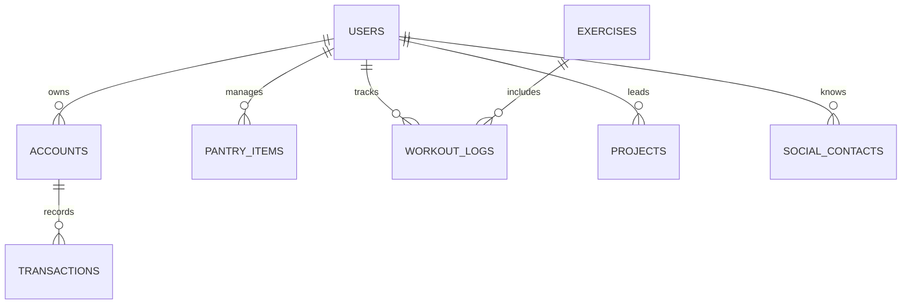

# Locked_In - Personal ERP & Telemetry System

Unified system for life management: finances, inventory, physical training, and goals.

## Tech Stack
* **Backend:** Python 3.11, FastAPI, SQLModel (SQLAlchemy + Pydantic), JWT & Bcrypt
* **Database:** PostgreSQL (Supabase) / SQLite (In-Memory Testing)
* **Frontend:** React, Vite, TailwindCSS, Axios, Lucide Icons (PWA Ready)
* **QA & CI/CD:** Pytest, Ruff, GitHub Actions, Docker

## Database Architecture

## Security & Multi-Tenant Architecture (Demo Mode)
To showcase this project in a public portfolio without exposing sensitive financial or personal data, the backend implements a logical **Multi-Tenant** architecture supporting an `admin` role (private) and a `demo` role (one-click recruiter access):

* **Database-Level Isolation (`user_id`):** Every operational entity (accounts, pantry inventory, workout logs) is strictly bound to the `users` table via foreign keys. No global records exist without tenant ownership.
* **Dependency Injection (`Depends(get_current_user)`):** Protected endpoints validate the JWT signature on every HTTP request, extracting the user identity and scoping all SQL queries to the authenticated `user_id`.

## Frontend & Progressive Web App (PWA)
* **Installable Mobile Experience:** Configured via `vite-plugin-pwa` with a custom `manifest.json` and Service Worker, allowing standalone installation on mobile devices for quick access at the gym or grocery store.
* **Centralized HTTP Client:** Modular `Axios` instance configured with request interceptors to automatically inject Bearer JWT tokens stored in `localStorage`.
* **Responsive Dark UI:** Built with TailwindCSS featuring a unified login flow for both personal credentials and instant Demo Mode provisioning.